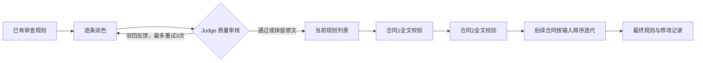

# Contract Rule Optimizer

把已有合同审查规则整理成更明确的审查指令，再按合同顺序校验规则，保存每次修改的轨迹。

**English summary:** A small Python research toolkit that polishes existing contract review rules with a quality judge, then validates the full rule set against contracts sequentially. Includes a deterministic offline demo and a configurable chat-completions HTTP adapter.


本项目整理自两层规则优化实验（v5）。它保留原来的核心方法，增加可安装入口、严格输出校验、合成示例和离线测试。当前版本是研究原型；没有发布真实合同、内部数据、历史实验结果或模型效果指标。

## 方法



1. **规则润色**：明确触发条件、审查动作和参数，保留原有立场、具体枚举和例外；没有依据的数值不得补写。提示词默认站在乙方（软件供应商）立场。
2. **Judge**：对照原始规则检查是否增加义务、删除防御条款、改变有利参数或捏造依据。默认最多生成 4 次候选（首次 + 3 次驳回重试），检测重复候选和回退原文；最终失败保留原文。
3. **全文合同校验**：每次把全部当前规则与一份合同全文交给模型。提示词要求仅调整冲突处，对可以兼容的参数尝试区间化，保留核心防御底线；本阶段没有第二次独立 Judge。
4. **修改记录**：记录润色尝试、每份合同的前后快照、修改理由和失败状态，方便人工追踪。

这是规则优化工具。它输出新的审查指令，不输出法律结论或逐条合同风险报告。

## 快速运行：无需账号、密钥或模型下载

需要 Python 3.10 或更高版本。核心运行时只使用 Python 标准库。

```bash
git clone https://github.com/ph-kleene/contract-rule-optimizer.git
cd contract-rule-optimizer
python -m venv .venv
```

Linux / macOS 用 `source .venv/bin/activate`，Windows PowerShell 用 `.venv\Scripts\Activate.ps1`。然后执行：

```bash
python -m pip install -e .
contract-rule-optimizer --mock --rules examples/rules.json --contracts examples/contracts.json --output output/demo.json
python -m unittest discover -s tests -v
```

也可用 `python -m contract_rule_optimizer` 替代命令名称，参数相同。输出 JSON 位于 `output/demo.json`，目录默认不会提交。

`--mock` 全程离线。它给合成规则添加固定审查前缀，并针对示例中的 `DEMO-PAYMENT` 把 `30日` 固定替换为 `30至45日`，以展示修改记录。这是程序流程演示，**没有法律推理或模型效果评估**，不适合处理自定义合同。

## 接入模型

HTTP 适配器请求 `${LLM_BASE_URL}/chat/completions`，发送 `model`、`messages`、`temperature`，读取 `choices[0].message.content`。模型需要根据提示词返回 JSON 对象。服务端必须实现这一请求和响应格式；不同服务的参数、限额和 JSON 输出能力需要自行核对。

设置三个环境变量（`.env.example` 仅说明变量名称，CLI 不会自动读取 `.env`）：

| 变量 | 含义 |
| --- | --- |
| `LLM_BASE_URL` | 服务 API 基础地址，包含服务所需路径前缀，使用 HTTPS；本地 localhost 服务允许 HTTP |
| `LLM_API_KEY` | 自己的访问凭据，只保存在本机环境变量中 |
| `LLM_MODEL` | 服务端支持的模型标识 |

配置完成后去掉 `--mock`：

```bash
contract-rule-optimizer --rules examples/rules.json --contracts examples/contracts.json --output output/live.json
```

真实模式会把输入的规则和合同全文发送到配置的服务。选择输入数据前，应确认自己有权使用这些材料并同意该服务的数据处理方式。适配器拒绝携带凭据的 URL 和 HTTP 重定向，不把密钥或完整服务错误正文写入结果。

## 输入和输出

`--rules` 接收 JSON 数组，要求唯一且非空的 `rule_id`，以及非空 `category`、`text`：

```json
[
  {"rule_id": "RULE-001", "category": "付款", "text": "已有的审查规则文本"}
]
```

`--contracts` 接收合同名称到**全文**的 JSON 对象，按文件中的键顺序逐篇处理；空对象 `{}` 表示只润色规则：

```json
{"示例合同": "完整合同文本"}
```

输入是已抽取的 UTF-8 文本；本版本不解析 PDF / Word。示例里的名称、主体、条款和规则全部为合成演示材料，不来源于真实合同。

| 输出字段 | 内容 |
| --- | --- |
| `mode` / `status` | 离线或真实模式，以及是否出现保留原文的失败 |
| `polish_layer` | 每条规则的候选、Judge 反馈、尝试次数、是否跳过 |
| `validate_layer` | 按合同顺序的规则快照、修改理由、错误码 |
| `final_rules` | 原规则、润色后规则和最终规则 |

`--max-retries` 默认 3；`--max-contract-chars` 默认 0，表示不限制。指定字符上限后，超过上限的合同会记为失败并保留当前规则，**不会截断全文**。正常完成退出码为 0，输入/配置错误为 1，输出含跳过或校验失败时为 2；退出码 2 时仍保存可检查的结果。

## 可靠性边界

- Judge 和校验器都是模型调用，可能共享同一个模型的偏差；Judge 通过不保证法律正确。
- 合同输入顺序会影响最终规则。逐篇迭代不会自动回看此前合同，也不保证最终规则与全部合同同时兼容。
- 全文加全部规则可能超过模型上下文或服务限额。没有自动分块、跨合同冲突消解或回归评估。
- 校验结果必须按唯一 `rule_id` 完整对齐；未知、重复、缺失 ID，空规则文本，或不一致的 `changed` 标记会导致本轮保留原文。没有原实验的按索引兜底更新。
- 出错和格式异常不默认放行。润色最多进行有限次反馈修改，合同校验没有网络自动重试；输出需要人工复核。
- 公开版未复现原实验的线上服务或验证真实模型质量。离线测试只验证流程和失败保护。

## 另一条实验路线

原实验还探索过 stage1_5 路线：润色后，对单条规则检索合同片段，再校验该规则。它与本项目的 v5 全文逐篇校验在输入范围和迭代方式上不同。本发布选择可独立运行的 v5 主线，检索路线仅记录在 [方法说明](docs/methods.md)，没有打包原向量模型、索引或实验数据。

## 目录

```text
src/contract_rule_optimizer/  输入校验、提示词、模型适配器、优化流程、CLI
examples/                    全合成规则与合同
tests/                       无网络依赖的流程和失败保护测试
docs/                        方法关系与设计取舍
```

欢迎通过 Issues 提供可复现的合成案例。请勿上传真实合同、客户信息或服务凭据。

MIT License · Huang Peng / [ph-kleene](https://github.com/ph-kleene)
